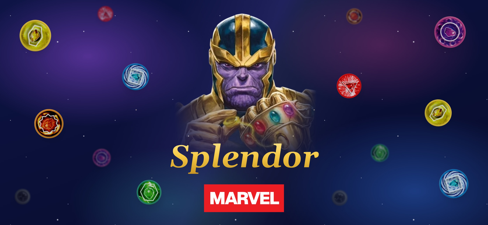

# Marvel Splendor

[](https://marvel-splendor.vercel.app)

**[Play it at marvel-splendor.vercel.app](https://marvel-splendor.vercel.app)**

A web version of the board game **Splendor: Marvel Edition**. Recruit heroes, gather the Infinity Stones, assemble the Avengers and claim the Gauntlet. Play against the computer, or open a private room and share the code with friends.

It is built for a phone held on its side, and can be added to the home screen to run like an app.

> This is a personal project. Marvel and Splendor are licensed properties; the art is supplied by the owner and the project is not for commercial use.

## What it does

- **Play vs Computer:** 2 to 4 players, with easy, normal or hard bots.
- **Private games:** create a room, share a six-letter code, and play live.
- **Timers:** an optional turn timer and game clock.
- **Away players:** a bot takes over for anyone who misses 3 turns in a row, until they come back.
- **Profiles:** a picture, name and username, with stats and a record of every finished game.
- **Installed app:** home screen icon, launch picture, and full-screen play on iPhone.

## Built with

| Part | Tool |
|---|---|
| App | Next.js 16 (App Router), React 19, TypeScript |
| Styling | Tailwind CSS 4, shadcn/ui |
| Database | Postgres on Neon, through Prisma |
| Sign-in | Auth0 |
| Live play | Pusher Channels |
| Profile pictures | Cloudflare R2 |
| Tests | Vitest |
| Hosting | Vercel |

> **This Next.js has breaking changes** from earlier versions. Read the guides in `node_modules/next/dist/docs/` before writing code against it. See [AGENTS.md](AGENTS.md).

## Getting started

You need Node 22 and pnpm.

1. **Install:**

   ```bash
   pnpm install
   ```

2. **Set up the environment.** Copy `.env.example` to `.env` and fill it in. Each value says where to find it.

   | Group | Needed for |
   |---|---|
   | `DATABASE_URL` | Everything |
   | `AUTH0_*`, `APP_BASE_URL` | Signing in |
   | `PUSHER_*`, `NEXT_PUBLIC_PUSHER_*` | Private games |
   | `R2_*` | Uploading a profile picture |
   | `OPENAI_API_KEY` | Bot banter (not built yet) |

3. **Set up the database:**

   ```bash
   pnpm db:update
   ```

4. **Run it:**

   ```bash
   pnpm dev
   ```

   Open [http://localhost:3000](http://localhost:3000). To try a private game on your own, sign in as two different players in two browsers.

## Commands

| Command | What it does |
|---|---|
| `pnpm dev` | Runs the app for development |
| `pnpm build` | Builds the app for production |
| `pnpm start` | Runs the production build |
| `pnpm lint` | Checks the code style |
| `npx vitest run` | Runs the tests |
| `npx tsc --noEmit` | Checks the types |
| `pnpm db:update` | Applies `prisma/schema.prisma` to the database and rebuilds the database client |
| `pnpm images` | Refreshes the picture fingerprints. Runs by itself before `dev` and `build` |
| `pnpm launch:images` | Retakes the iPhone launch pictures. Needs the dev server running, Google Chrome and a Mac |
| `pnpm collection:backfill` | Shows what each player's collection would hold, from the games played to the end. Add `--yes` to save it |
| `pnpm games:clear` | Shows what clearing every game would delete. Add `--yes` to delete; this cannot be undone |
| `pnpm games:reset` | A fresh start: the same, and every player's stats set back to zero. Players, names and pictures are kept. Add `--yes` to do it |

## How the project is laid out

| Folder | What is in it |
|---|---|
| `app/` | Pages and API routes |
| `components/` | The board (`game/`), menus (`home/`, `lobby/`), and profiles (`profile/`) |
| `lib/engine/` | The rules of the game. Pure functions, no database or network |
| `lib/bot/` | How the computer chooses its moves |
| `lib/` | Everything else: live play, game history, stats, sign-in, storage |
| `data/` | Cards, locations, art paths and launch screen sizes |
| `prisma/` | The database schema |
| `public/` | Card art, game art, icons and launch pictures |
| `scripts/` | The tools behind the commands above |
| `tests/` | Rule tests, on a frozen copy of the card data |
| `auth0/` | The themed login page, to paste into the Auth0 dashboard |

## Changing the game's data

- **Cards:** `data/cards.json`. Each card needs an `id`, `name`, `side` (`hero`, `villain` or `both`), `groups` (its teams, three at most, or `[]`), `level`, `bonus`, `points`, `cost` and `tags`. `image` is optional. Saved games refer to cards by `id`, so never reuse or renumber one.
- **Locations:** `data/locations.json`.
- **Board art:** `data/assets.json`. Set a value to a path under `public/`, or leave it `null` to keep the drawn placeholder.
- **Launch screens:** `data/launch-screens.json`. After adding one, run `pnpm launch:images`.

Changing a card's cost, points or tags while games are in progress stops those games from replaying missed moves. Adding a `name` or `image` is safe.

## Deploying

The app is hosted on Vercel.

1. Set every value from `.env.example` in the Vercel project, with `APP_BASE_URL` as the live address.
2. Apply the schema to the production database with `pnpm db:update`.
3. Paste `auth0/login.html` into the Auth0 Universal Login template, and add the live address to the allowed callback and logout URLs.

## More detail

[ARCHITECTURE.md](ARCHITECTURE.md) has the full rules reference, the data model, how live play works, the known limitations of the timers and idle rules, and the roadmap.
